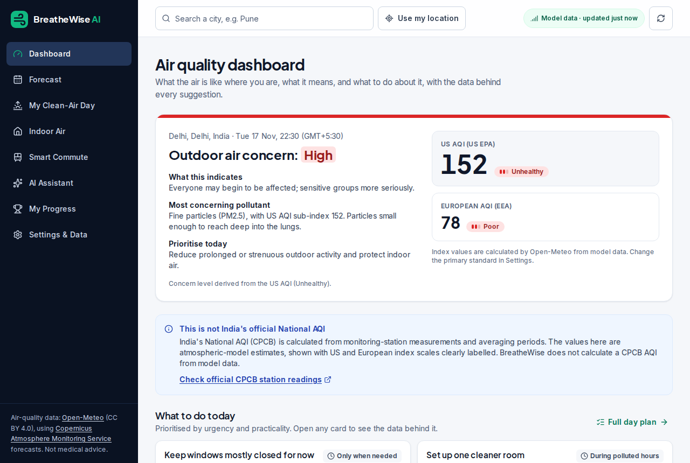
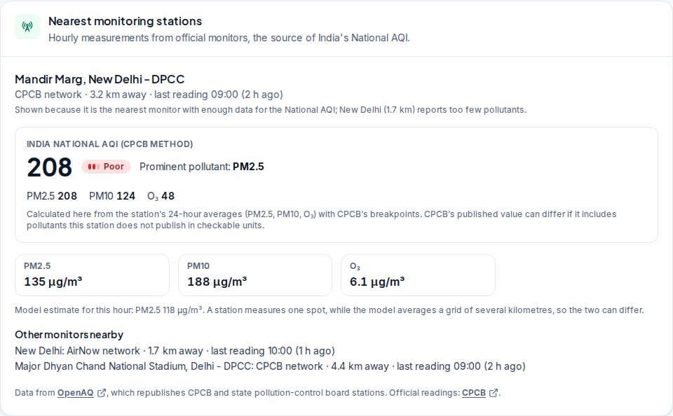
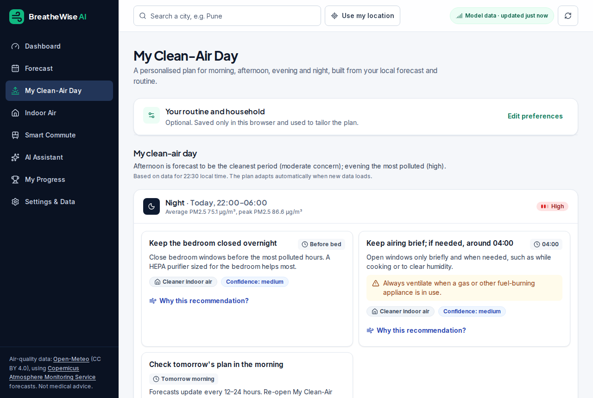
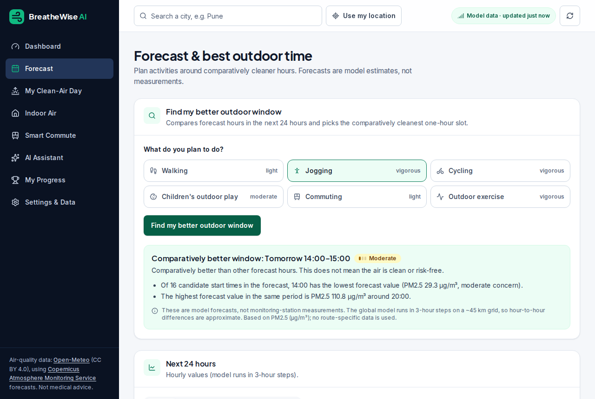
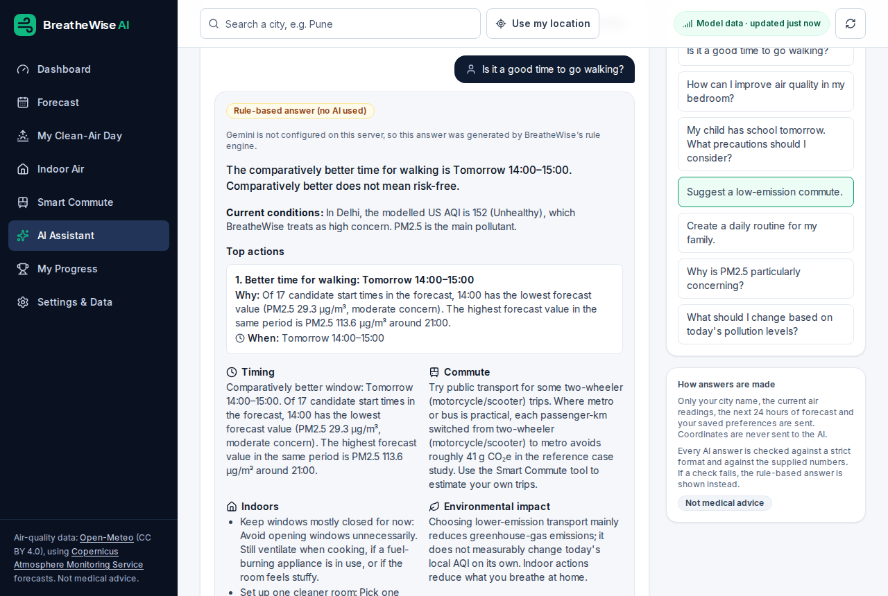
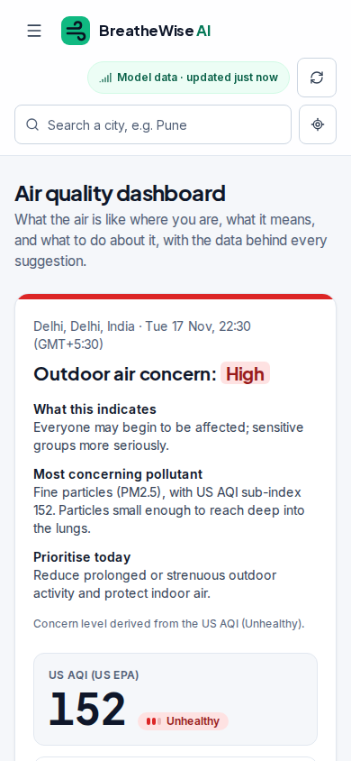

# BreatheWise AI

**Understand the air. Make smarter choices. Breathe better.**

BreatheWise AI is a location-aware urban air-quality assistant for Indian households, and it works internationally wherever data is available. It combines **live measurements from official monitoring stations** (CPCB and state boards, via OpenAQ) with Copernicus model forecasts, and turns them into practical, explained daily decisions: when to go outside, when to open windows, how to protect your home, and how to commute with lower emissions.

Built for **Google PromptWars Virtual: Main Challenge 06, Urban Air Quality Assistant**.

**Live demo: https://breathewise-ai-vercel.vercel.app/**

### How to try it (sample inputs)

| Try this                                                                                                | What you should see                                                                                                                                                              |
| ------------------------------------------------------------------------------------------------------- | -------------------------------------------------------------------------------------------------------------------------------------------------------------------------------- |
| Search **Delhi**, **Mumbai**, **Kolkata** or **Noida** (or press the location button)                   | The model estimate (US and European AQI, pollutants) and **Nearest monitoring stations**: the station's name, distance, reading time and an **India National AQI (CPCB method)** |
| Ask the assistant **"Is it a good time to go walking?"** or **"Should I open the windows now?"**        | A Gemini answer grounded in that location's model and station data, labelled with its source; the rule engine answers if AI is unavailable                                       |
| Forecast → **Find My Better Outdoor Window** → Jogging, with **Children** ticked                        | The comparatively cleaner hour in the next 24 hours, with extra caution for children                                                                                             |
| My Clean-Air Day → Edit preferences: Office, Metro, leave **08:30**, return **18:30**, Walking, Evening | A morning-to-night plan; every item explains why                                                                                                                                 |
| Commute: **10 km**, **2 trips a day**, **5 days**, Car → Metro                                          | 100 passenger-km a week; about **13.8 kg CO₂e saved per week**, with the method shown                                                                                            |
| Commute → **Combine errands**: 3 trips, 6 km each, one 10 km loop, once a week, Car                     | **8 km a week** saved, about **5.62 kg CO₂e a month**, with the formula shown                                                                                                    |
| Settings → **Demo mode**                                                                                | Clearly labelled sample data, including a real captured station report, with no network calls for air data                                                                       |

[](https://github.com/NextGenDev-KSK/breathewise-ai/actions/workflows/ci.yml)



---

How it was built (research, tools, prompt design and its evolution, testing, and how AI was used): [docs/DEVELOPMENT-PROCESS.md](docs/DEVELOPMENT-PROCESS.md).

## Contents

1. [Problem statement](#1-problem-statement)
2. [Product overview](#2-product-overview)
3. [Features](#3-features)
4. [Screenshots](#4-screenshots)
5. [Technology stack](#5-technology-stack)
6. [Architecture](#6-architecture)
7. [Data flow](#7-data-flow)
8. [AI architecture](#8-ai-architecture)
9. [API sources](#9-api-sources)
10. [Data limitations](#10-data-limitations)
11. [Security and privacy](#11-security-and-privacy)
12. [Accessibility](#12-accessibility)
13. [Testing](#13-testing)
14. [Local installation](#14-local-installation)
15. [Environment variables](#15-environment-variables)
16. [Deployment](#16-deployment)
17. [Known limitations](#17-known-limitations)
18. [Roadmap](#18-roadmap)
19. [Attribution and licences](#19-attribution-and-licences)

---

## 1. Problem statement

An AQI notification tells people the air is bad, but not what to do about it. Urban families, especially in Indian cities during winter pollution episodes, need answers to concrete questions:

- When today is it comparatively better to walk, run or let the children play outside?
- Should I open the windows now, or later?
- How do I keep the bedroom air cleaner tonight?
- Is switching my commute worth it, and what does it actually change?

Most tools either show raw numbers or give generic AI advice that is not grounded in local data.

## 2. Product overview

BreatheWise is built around an **Explainable Clean-Air Action Engine**. Every recommendation states:

| Question                   | Where it appears                                                              |
| -------------------------- | ----------------------------------------------------------------------------- |
| What should I do?          | Card title and description                                                    |
| Why?                       | "Why this recommendation?" → _Reason_                                         |
| When?                      | Time chip (e.g. _Tomorrow 14:00–15:00_)                                       |
| What data triggered it?    | _Data behind it_ (exact values)                                               |
| What benefit can I expect? | Impact badge (less exposure, cleaner indoor air, lower CO₂e, better-informed) |
| How reliable is it?        | Confidence badge plus the _Data confidence_ panel                             |
| Limitations?               | _Limitations_ list on every card                                              |

Core principles: **data before AI** (deterministic rules compute everything; Gemini only explains), **transparency** (model estimates are never presented as station measurements; station readings always name the station, its distance and the reading time), **privacy** (no account, local storage only), and **graceful degradation** (fully usable without Gemini, offline from a saved copy, or with sample data).

## 3. Features

| Module                                           | What it does                                                                                                                                                                                                                                                                                                                                                                                                                                                                   |
| ------------------------------------------------ | ------------------------------------------------------------------------------------------------------------------------------------------------------------------------------------------------------------------------------------------------------------------------------------------------------------------------------------------------------------------------------------------------------------------------------------------------------------------------------ |
| **Air-quality dashboard**                        | City search (debounced, cancellable), opt-in geolocation (rounded to about 1 km), US AQI and European AQI with their standards named, PM2.5, PM10, NO₂, SO₂, CO, O₃ (+ dust, ammonia when available), dominant pollutant from US AQI sub-indices, plain-language interpretation, WHO 2021 guideline context, prioritised actions, and a data-confidence panel.                                                                                                                 |
| **Monitoring stations and India's National AQI** | The nearest official monitors within 25 km (CPCB and state pollution-control boards in India, via OpenAQ) with name, distance and reading time. For Indian stations, a **National AQI calculated with the CPCB method** from 24-hour station averages (16-hour minimum, at least three pollutants including PM2.5 or PM10), its prominent pollutant and every sub-index. Model values are never labelled as the National AQI.                                                  |
| **Forecast and better outdoor window**           | 24-hour charts (PM2.5, PM10, US AQI, European AQI) with text summaries and data tables, a multi-day overview, and **Find My Better Outdoor Window** for 6 activities. It ranks hours by hourly PM2.5, adjusts caution for exertion and sensitive household members, says plainly when every hour is poor, and never calls a time "safe".                                                                                                                                       |
| **My Clean-Air Day**                             | Optional routine and household preferences (no medical questions) produce a plan for night, morning, afternoon and evening covering activity timing, ventilation, commute (with carpooling and respirator guidance where relevant), cooking, bedroom and preparation for tomorrow. Students also get advice on outdoor games and PE. Every item is explained, and the plan adapts automatically when data changes.                                                             |
| **Indoor Air Advisor**                           | Live ventilation status, with a better airing time when the forecast shows one, plus a personalised checklist (saved locally, resets daily), guidance on cooking, dust, sources and purifiers, an honest **indoor plants** section (good for wellbeing, but negligible filtration at home scale, with the research cited), and a purifier-size (CADR) helper. It never recommends ozone generators and never invents indoor measurements.                                      |
| **Smart Commute**                                | Car, **carpool**, two-wheeler, bus, metro, walking and cycling compared with documented OECD 2023 Indian case-study factors (carpool = the car factor shared by three people, stated as an estimate). Shows weekly, monthly and relative CO₂e with the full methodology. **Combine errands** estimates the distance and CO₂e saved by one combined trip instead of separate round trips, using only the user's own distances. CO₂e is kept explicitly separate from local AQI. |
| **AI Clean-Air Assistant**                       | Gemini (server-side) answers in a strict JSON schema, grounded in the local snapshot. Responses are validated with Zod on the server and the client, then checked for invented numbers and guarantee language. On any failure, or with no key, the deterministic engine answers, and the UI says which source answered.                                                                                                                                                        |
| **My 7-Day Clean-Air Mission**                   | Seven daily habits with ticking, weekly bar chart, streak, per-habit totals and reset (with confirmation). It makes no community or citywide-impact claims.                                                                                                                                                                                                                                                                                                                    |
| **Settings and data sources**                    | Primary index (US or EU), 12/24-hour time, AI on/off, demo mode, clear all local data, full attribution and privacy summary. Every setting changes behaviour.                                                                                                                                                                                                                                                                                                                  |
| **Demo mode**                                    | Clearly labelled **SAMPLE DATA · DEMO MODE** on every screen. Sample data never mixes with live data and makes no network calls for air data. Works without a Gemini key.                                                                                                                                                                                                                                                                                                      |

## 4. Screenshots

All screenshots use real data. The station card shows live OpenAQ data for central Delhi on 22 Nov 2026; the others use Open-Meteo model data for Delhi captured on 17 Nov 2026 (the same response is the test fixture). The assistant is shown in rule-based mode.



| Plan                                                                                           | Better outdoor window                                               |
| ---------------------------------------------------------------------------------------------- | ------------------------------------------------------------------- |
|  |  |
| **Assistant (rule-based fallback)**                                                            | **Mobile**                                                          |
|      |                     |

## 5. Technology stack

| Layer      | Choice                                                                                                           |
| ---------- | ---------------------------------------------------------------------------------------------------------------- |
| Framework  | Next.js 16 (App Router, Turbopack), React 19, TypeScript 5.9 (`strict`, `noUncheckedIndexedAccess`)              |
| Styling    | Tailwind CSS 4 with design tokens, `lucide-react` icons, self-hosted Inter and Plus Jakarta Sans via `next/font` |
| Charts     | A custom accessible SVG chart (no chart library: saves about 100 KB of JS)                                       |
| Validation | Zod 4 everywhere data crosses a boundary                                                                         |
| AI         | `@google/genai` 3.4 (server-only), model `gemini-3.5-flash-lite` by default (low latency, minimal thinking)      |
| Data       | Open-Meteo Air Quality and Geocoding APIs (no key needed)                                                        |
| Tests      | Vitest 5, React Testing Library, Playwright 1.65, `@axe-core/playwright`                                         |
| Hosting    | Vercel (no database, no auth, no paid services required)                                                         |

Runtime dependencies: `next`, `react`, `react-dom`, `@google/genai`, `zod`, `lucide-react`, `server-only`. That's all of them.

## 6. Architecture

```
app/                        Routes (server components) + API route handler
  api/assistant/route.ts    POST: same-origin, validated, rate-limited Gemini proxy; GET: configured?
components/                 Client UI, one concern per file
  app/  air/  dashboard/    App shell and providers, air-quality widgets, dashboard
  forecast/ plan/ indoor/   Feature modules, each split into small focused components
  commute/ assistant/ progress/ settings/
  ui/                       Shared kit: Button, Card, Dialog, ConfirmDialog, FormField,
                            SegmentedControl, Switch, ExternalLink, ProgressBar, Toast…
hooks/                      useStoredState (useSyncExternalStore over localStorage), useAirQuality,
                            useCitySearch, useAssistantChat, useDetectLocation, useClock, useHydrated
lib/
  air/                      Open-Meteo client, validation, indices, geocoding, cache, chart series
  engine/                   Deterministic engine (pure functions):
    analysis, activities,     concern, trends, activity profiles and caution policy,
    windows, indoor,          better outdoor window, ventilation and checklist,
    emissions, mission,       CO₂e and form parsing, 7-day mission,
    provenance                source labels and confidence
    plan/                     daily plan: periods, shared items, one builder per period
    recommendations/          ten rules grouped by topic + a stable, prioritised runner
  ai/                       Schemas + shared limits, prompt, grounding guard, Gemini client,
    fallback/                 rule-based answers: intent detection + one handler per intent
  content/                  Static guidance and shared user-facing caveats
  security/                 CSP builder, rate limiter, same-origin check
  math.ts collections.ts    Small typed helpers (mean, minBy/maxBy, recordFromKeys…)
types/                      Domain types (air, preferences, recommendations)
proxy.ts                    Per-request nonce + strict Content-Security-Policy
tests/                      unit/ (mirrors the source tree), integration/, e2e/, fixtures/ (real captured API responses)
```

The recommendation logic lives in `lib/engine` as pure functions. Neither React components nor the Gemini prompt contain decision rules. Quality gates enforced in CI: Prettier, ESLint with type-aware rules and complexity/size budgets (complexity ≤ 12, ≤ 80 lines per function, ≤ 300 lines per file; zero warnings, zero suppressions), jscpd (0 duplicated blocks), a doc comment on every exported function, Knip (no unused files, exports or dependencies), strict TypeScript, coverage thresholds, and CodeQL. See [docs/ARCHITECTURE.md](docs/ARCHITECTURE.md) and [docs/CODE-QUALITY-AUDIT.md](docs/CODE-QUALITY-AUDIT.md).

## 7. Data flow

```
User picks city ──► Open-Meteo Geocoding (browser) ──► Place (stored locally)
        │
        ▼
Open-Meteo Air Quality (browser, explicit CAMS domain, timezone=auto)
        │  Zod validation · nulls stay null · 10-min cache · AbortController
        ▼
AirQualitySnapshot ──► Deterministic engine ──► Dashboard, Forecast, Plan, Indoor, Assistant
        │                                            │
        │ (last good copy, labelled "Saved copy")    ▼
        ▼                                     Assistant context (no coordinates)
   localStorage                                      │
                                                     ▼
                                   POST /api/assistant ──► Gemini (JSON schema)
                                                     │
                            Zod + grounding guard ◄──┘   (failure → rule engine)
```

Model data is fetched directly by the browser. Station data comes through `GET /api/stations`, which keeps the OpenAQ key on the server: the browser sends coordinates rounded to about 1 km, the server asks OpenAQ for monitors within 25 km, applies the CPCB method, and returns a validated report. The server neither logs nor stores coordinates; it keeps a 10-minute response cache keyed by the rounded point. Coordinates never reach Gemini.

## 8. AI architecture

1. **Context:** `buildAssistantContext` sends only a place label, current model readings, the next 24 hours of PM2.5 and US AQI, the nearest station's name, distance, measurements and CPCB-method National AQI, the deterministic outdoor window, the top rule recommendations and boolean preferences. It never sends coordinates.
2. **Prompt:** a system instruction with 14 non-negotiable rules (no invented numbers, model ≠ station, station values named as station measurements, never compute a National AQI itself, never "safe", no diagnoses or percentages, CO₂e ≠ AQI, no ozone generators, user text is untrusted, personalise by routine, commute and household, including public transport, carpooling and combined trips). The user text is delimited separately from the data.
3. **Generation:** `responseMimeType: application/json` with a `responseJsonSchema`, minimal thinking (Flash-Lite), 1,400 max output tokens, a 30 s budget via `AbortSignal`, and up to 3 attempts with 1–4 s backoff for quota or server errors (429/5xx). An exhausted quota is reported distinctly (`ai_rate_limited`).
4. **Validation:** a Zod schema on the server, then `findUnsupportedClaims` rejects any concentration or AQI number not present in the data, any guarantee or "completely safe" wording, and any quantified benefit ("reduce exposure by 40%"). The client validates again before rendering.
5. **Fallback:** `buildRuleBasedAnswer` detects intent (outdoor, children, indoor, commute, routine, education) and answers from the same engine in the same schema. The UI shows **Rule-based answer (no AI used)** with the reason.

Output schema: `summary`, `risk_context`, `top_actions[{action, why, when}]`, `timing`, `indoor_recommendations`, `commute_recommendation`, `environmental_impact`, `uncertainties`, `disclaimer`.

## 9. API sources

| API                                                                      | Use                                                                         | Notes                                                                                                    |
| ------------------------------------------------------------------------ | --------------------------------------------------------------------------- | -------------------------------------------------------------------------------------------------------- |
| [Open-Meteo Air Quality](https://open-meteo.com/en/docs/air-quality-api) | Current values, US and European AQI with sub-indices, 4-day hourly forecast | Explicit `domains`: `cams_europe` inside Europe (falls back to global if empty), otherwise `cams_global` |
| [Open-Meteo Geocoding](https://open-meteo.com/en/docs/geocoding-api)     | City search                                                                 | 2–80 character queries, 300 ms debounce, aborts outdated requests                                        |
| [OpenAQ v3](https://docs.openaq.org/)                                    | Nearest official monitors, latest hourly readings, 24-hour history          | Server-side (key never sent to the browser); reference monitors only; 10-minute cache; optional          |
| Google Gemini API                                                        | Explanations only                                                           | Server-side; optional                                                                                    |

## 10. Data limitations

- **Model estimates, not measurements.** CAMS Global (used for India) has a ~45 km (0.4°) grid and 3-hourly steps (hourly values are interpolated), with a 5-day forecast updated every 12 hours. CAMS Europe has a ~11 km grid, hourly steps and a 4-day forecast.
- **Model values are not India's National AQI.** BreatheWise shows the model's US and European AQI with their names, and calculates a National AQI only from station measurements, with CPCB's averaging rules. It uses only station streams published in µg/m³: some CPCB streams on OpenAQ are labelled "ppb" although their values match CPCB's µg/m³ and mg/m³ figures, so they are left out rather than risk a unit error. The index can therefore differ from CPCB's published value when NO₂, SO₂ or CO would be the prominent pollutant.
- **Station coverage and lag.** Only monitors that reported within the last 3 hours are shown; OpenAQ republishes CPCB data with a delay of about 1–3 hours.
- **Open-Meteo's US AQI for particles uses a 24-hour rolling average**, so it lags. Timing advice therefore ranks hours by hourly PM2.5 concentration.
- **No indoor measurements.** Indoor advice is based on outdoor conditions only.
- **Emission factors are illustrative** life-cycle values from one Indian case study.

Details: [docs/DATA-METHODOLOGY.md](docs/DATA-METHODOLOGY.md).

## 11. Security and privacy

- Gemini key and model are **server-only** (`GEMINI_API_KEY`, `GEMINI_MODEL`; never `NEXT_PUBLIC_`). `server-only` makes a client import a build error.
- `/api/assistant`: same-origin only, so other websites cannot spend the AI quota through visitors' browsers (403); JSON-only (415), a 16 KB streaming body limit (413), Zod validation (400), a 600-character question limit, best-effort rate limiting at 10/min per IP (429 + `Retry-After`), a 30 s AI budget (504), sanitised errors with no stack traces or upstream messages, and `Cache-Control: no-store`.
- **Strict CSP** with a per-request nonce and `strict-dynamic`, no `unsafe-eval` in production, `frame-ancestors 'none'`, and `connect-src` limited to Open-Meteo. Also sets HSTS, `nosniff`, `Referrer-Policy`, `Permissions-Policy` (geolocation self only), COOP, CORP and `X-Permitted-Cross-Domain-Policies: none`.
- GitHub CodeQL (`security-extended`) scans every push and weekly; Dependabot proposes dependency updates.
- No `dangerouslySetInnerHTML` (enforced by ESLint `react/no-danger`); all AI text renders as React text.
- No account, analytics or tracking. localStorage holds only settings, preferences, chosen place, checklist and mission progress, all Zod-validated on read. A **Clear all local data** button removes them.

Full audit: [docs/SECURITY.md](docs/SECURITY.md).

## 12. Accessibility

Targets WCAG 2.2 AA:

- Semantic landmarks, one `h1` per page, a skip link, and visible 3 px focus rings.
- The city search follows the ARIA 1.2 combobox pattern (arrow keys, Enter, Escape, live result count).
- Modals use native `<dialog>` with focus return.
- Toasts use live regions, and form errors are tied to their fields with `aria-invalid` and `aria-describedby`.
- Air quality is never shown by colour alone: every level has text and shape cues, and every chart has a text summary and a data table.
- Touch targets are at least 44 px and reduced-motion preferences are respected.
- **axe-core reports 0 WCAG 2.2 A/AA violations on all 8 pages at desktop and mobile sizes** (automated, in the e2e suite). **Lighthouse Accessibility is 100** on the pages measured.

## 13. Testing

| Command                   | What runs                                                                                              | Latest result                                                                      |
| ------------------------- | ------------------------------------------------------------------------------------------------------ | ---------------------------------------------------------------------------------- |
| `npm run format:check`    | Prettier                                                                                               | pass                                                                               |
| `npm run lint`            | ESLint: Next core-web-vitals + type-aware rules + complexity budgets, 0 warnings                       | pass, 0 suppressions in source                                                     |
| `npm run lint:unused`     | Knip: unused files, exports and dependencies                                                           | pass                                                                               |
| `npm run lint:duplicates` | jscpd: copy-pasted blocks in shipped code (threshold 0)                                                | 0 clones                                                                           |
| `npm run typecheck`       | `tsc --noEmit`, strict + `noUncheckedIndexedAccess`                                                    | pass                                                                               |
| `npm run test:coverage`   | Vitest: 74 files mirroring the source tree, unit + integration + hook + component, enforced thresholds | **402 passed**; 97.6 % statements, 98.5 % lines                                    |
| `npm run test:e2e`        | Playwright on a production build, all APIs mocked, axe audits                                          | Local (Chromium + Firefox): 51 passed, 102/102 repeated; CI adds WebKit: 67 passed |
| `npm run build`           | Production build                                                                                       | pass                                                                               |

External services are never called by the tests: Open-Meteo fixtures are real captured responses, and Gemini is mocked at the SDK and HTTP levels. WebKit (Safari engine) runs in CI, inside the official Playwright Docker image. See [docs/TESTING.md](docs/TESTING.md).

## 14. Local installation

Requirements: **Node.js 22.12 or newer** (see `.nvmrc`) and npm.

```bash
git clone https://github.com/NextGenDev-KSK/breathewise-ai.git breathewise
cd breathewise
npm ci
cp .env.example .env.local      # optional: add GEMINI_API_KEY for AI answers
npm run dev                     # http://localhost:3000
```

Production build and full verification:

```bash
npm run verify                  # format, lint, unused-code, typecheck, tests, build
npx playwright install chromium firefox  # once, for end-to-end tests
npm run test:e2e
npm run repo:size               # checks the tracked repository stays under 9 MB
```

No key? The app runs fully in rule-based mode. To explore without choosing a city, choose **Try demo** in the welcome dialog (sample data, clearly labelled).

## 15. Environment variables

| Variable         | Required | Description                                                                                                                                                                                               |
| ---------------- | -------- | --------------------------------------------------------------------------------------------------------------------------------------------------------------------------------------------------------- |
| `GEMINI_API_KEY` | No       | Google AI Studio key. Without it, the assistant uses the rule engine.                                                                                                                                     |
| `OPENAQ_API_KEY` | No       | Free key from [OpenAQ](https://explore.openaq.org). Enables nearest monitoring-station readings and the CPCB-method National AQI. Without it, the station card says station data is not configured.       |
| `GEMINI_MODEL`   | No       | Defaults to `gemini-3.5-flash-lite`, Google's stable low-latency Flash-Lite model (verified 2026-11-18). `gemini-3.8-flash` also works but answered in 13–30 s in live tests. Restricted to `[a-z0-9.-]`. |

All are read only on the server. Never prefix them with `NEXT_PUBLIC_`.

## 16. Deployment

The live demo runs on Vercel. To deploy your own copy:

1. Push the repository to GitHub.
2. In Vercel, choose **New Project**, import the repository, and keep the framework preset **Next.js**. No build settings need changing.
3. Optionally add `GEMINI_API_KEY` (and `GEMINI_MODEL`) and `OPENAQ_API_KEY` under **Settings → Environment Variables**.
4. Deploy. Vercel uses Node 22 by default.

Any Node 22 host works the same way: `npm ci && npm run build && npm start`.

## 17. Known limitations

- Rate limiting is in-memory and per serverless instance (best effort). Strict limits would need a shared store such as Redis.
- There is no reverse geocoding: a detected location is labelled "Your location".
- Model resolution (~45 km in India) cannot capture street-level or hyperlocal variation.
- The rule engine's intent detection is keyword-based and English-only.
- A light theme only. There is no offline service worker; the last good response is reused when a fetch fails.
- The dev-only dependency `picomatch` (via ESLint and Vite tooling) has a ReDoS advisory with no patched release yet. It is not shipped to users; see [docs/SECURITY.md](docs/SECURITY.md).

## 18. Roadmap

- Station history charts and a direct CPCB feed when an official API is available.
- Indoor-sensor integration (PM2.5 and CO₂) for measured indoor advice.
- Hindi and other Indian-language UI and assistant.
- Push alerts when a cleaner window opens.
- Dark theme and an installable PWA with offline caching.

## 19. Attribution and licences

- Air-quality and geocoding data: **[Open-Meteo.com](https://open-meteo.com/)**, CC BY 4.0, free tier for non-commercial use. Air-quality forecasts are based on the **Copernicus Atmosphere Monitoring Service (CAMS)** and contain modified Copernicus Atmosphere Monitoring Service information. Geocoding is based on GeoNames (CC BY 4.0).
- Emission factors: OECD (2023), _Life-cycle assessment of passenger transport: an Indian case study_.
- Pollutant guideline values: WHO Global Air Quality Guidelines (2021).
- AI: Google Gemini API (optional).
- Code: MIT licence ([LICENSE](LICENSE)).

BreatheWise provides general information, not medical advice.

More documents: [Architecture](docs/ARCHITECTURE.md) · [Data methodology](docs/DATA-METHODOLOGY.md) · [Security](docs/SECURITY.md) · [Testing](docs/TESTING.md) · [Evaluation matrix](docs/EVALUATION-MATRIX.md)
